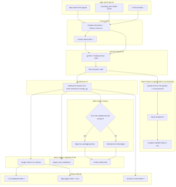

> **Project overview for reviewers**
>
> **Problem:** Cybersecurity reports arrive in varied formats and require consistent classification and routing.
>
> **Implementation:** An n8n workflow uses Gemini for structured extraction, while a Python/FastAPI enrichment service applies deterministic severity, sensitivity and routing policies. Results can be recorded in Sheets and distributed by email.
>
> **See it working:** [Workflow screenshots](screenshots/) · [Architecture](docs/architecture.md) · [Validation](docs/VALIDATION.md)
>
> **Scope:** This repository was developed as a defined AI engineering project. It demonstrates an implemented workflow and tested components, not a claim that it operates an enterprise SOC in production.

---

# Intelligent Cloud Document Analyst — Cybersecurity Incident Logs

Solution for the **n8n AI Engineering Project** (Google Gemini API), scenario **§10: Cybersecurity incident logs** — project name **HINDSIGHT**.

Upload a SIEM export, vulnerability scan, phishing report, or intrusion writeup → n8n extracts the text → **Gemini 3 Flash** returns structured JSON → a **Python FastAPI metadata service** enriches it (department, sensitivity, routing tag, confidence) → one row is appended to **Google Sheets** and a summary email is sent via **Gmail**.

> **Scenario vocabulary note (§5.4 ↔ §10):** as required, the prompt and enrichment are tailored to the cyber scenario — `incident_type` is this scenario's `classification` field (it is written to the `classification` column in Sheets), and entities cover `people / teams / systems / dates / error_codes`. `summary`, `sentiment`, `action_items`, and `confidence_score` keep the §5.4 names.



## The pipeline (§4, steps 1–6)

| Step | Requirement | Implementation |
|---|---|---|
| 1 | File detection | n8n Cloud **form upload** (grading path) or `incoming_docs/` **folder watcher** (self-hosted Docker path) |
| 2 | Text + image extraction | Cloud: `n8n/cloud/nodes/prepare.js` (text, PDF as Gemini `inline_data`, ZIP fan-out) · Self-hosted: `extractors/extract_document.py` (PyMuPDF, python-docx, embedded images) |
| 3 | Gemini AI analysis | HTTP Request node → `gemini-3-flash` · `x-goog-api-key` n8n credential · `temperature 0.2` · JSON mode · prompt in `prompts/extraction_prompt.md` |
| 4 | Metadata enrichment | `services/enrichment-api/` (FastAPI) or inline `n8n/cloud/nodes/enrich.js` — same deterministic rubric |
| 5 | Google Sheets write | Append one row per document to the `Incidents` tab (14 columns, §7.2) |
| 6 | Output + email | JSON + Markdown to `output_docs/` (self-hosted) · Gmail HTML summary per §8.2 |

**Core design principle: the LLM extracts; the service decides.** All scoring and routing is deterministic and unit-tested — e.g. CVSS 9.8 on a Nessus report floors severity to SEV1 with `routing_tag=escalate` even if the document says otherwise.

## Metadata API (§6)

`services/enrichment-api/` — Python 3.12, FastAPI, Pydantic v2, fully unit-tested.

| Endpoint | Purpose |
|---|---|
| `POST /enrich` | Department mapping, sensitivity, routing tag (`escalate` / `needs-review` / `auto-approved`), UUID + timestamp, confidence adjustment |
| `GET /health` | `{"status": "ok", ...}` probe |
| `GET /categories` | Document categories / severities / teams |
| `POST /sensitivity` | `public` / `internal` / `confidential` |

(Bonus endpoints: `/search`, `/index`, `/compare`, `/digest/preview`, `/metrics`.)

## Google Sheets (§7) and Gmail (§8)

Sheet `Incidents` tab columns (§7.2):

```
document_id | filename | file_type | processed_at | classification | department |
sentiment | confidence_score | summary | routing_tag | sensitivity | action_items |
cvss_score | cve_ids
```

Every run sends a Gmail message per §8.2: subject `[classification] New document processed: filename`, HTML body with classification, sentiment, department, sensitivity, routing tag, summary, action items, and a link to the Sheet.

## 📸 Screenshots

All evidence lives in [`screenshots/`](screenshots/), numbered by pipeline step:

| Step | Screenshot |
|---|---|
| Form upload → confirmation | [`01-form-upload.png`](screenshots/01-form-upload.png) · [`02-form-success.png`](screenshots/02-form-success.png) |
| n8n workflow canvas | [`03-workflow-canvas.png`](screenshots/03-workflow-canvas.png) |
| Successful execution (every node green) | [`04-execution-success.png`](screenshots/04-execution-success.png) |
| Google Sheet — one row per document | [`05-google-sheet.png`](screenshots/05-google-sheet.png) |
| Gmail summary email (§8.2) | [`06-email-summary.png`](screenshots/06-email-summary.png) |
| FastAPI OpenAPI docs | [`07-fastapi-docs.png`](screenshots/07-fastapi-docs.png) |
| Self-hosted n8n in Docker | [`08-n8n-docker.png`](screenshots/08-n8n-docker.png) |
| Bonus evidence (alert email, digest, dashboard, pgvector) | [`09`](screenshots/09-bonus-email-sev1-alert.png)–[`14`](screenshots/14-bonus-supabase-project.png) |

**Live grading path:** upload any file from `samples/` to the [public Cloud form](https://reemmor.app.n8n.cloud/form/21593841-f8b8-43a2-88a8-8595ad3e2f39) — no login needed. Reviewer guide: [`docs/REVIEWER-ACCESS.md`](docs/REVIEWER-ACCESS.md).

## Quick start

```powershell
# Tests (202 automated — same as CI)
python -m pytest services\enrichment-api -q      # 72 — enrichment API
python -m pytest tests\test_extractor.py -q      # 8  — PDF/DOCX/image extractor
node n8n\cloud\tests\test_node_bodies.mjs        # 76 — deployed Code-node bodies
node n8n\cloud\tests\test_prepare.mjs            # 9
node n8n\cloud\tests\test_compose.mjs            # 8
node n8n\cloud\tests\test_bonus_nodes.mjs        # 9
node n8n\cloud\tests\test_selfhosted_workflow.mjs # 20

# Run the metadata API locally → http://localhost:8000/docs
cd services\enrichment-api
python -m uvicorn app.main:app --reload --port 8000

# Full self-hosted stack (n8n :5678 + API :8000)
copy .env.example .env
docker compose up --build -d
python scripts\docker_smoke_test.py
```

## Repository map

| Path | Role |
|---|---|
| `n8n/cloud/` | Cloud workflow JSON + Code-node bodies (source of truth) + node tests |
| `n8n/hindsight_workflow.json` | Self-hosted workflow (import into Docker n8n) |
| `services/enrichment-api/` | §6 metadata microservice (FastAPI) + 72 tests |
| `extractors/` | PDF/DOCX/text extraction + embedded images (PyMuPDF) |
| `prompts/` | Gemini extraction + Vision prompts |
| `samples/` | Cyber incident fixtures (`.md`, `.pdf`, batch `.zip`) |
| `screenshots/` | Evidence, numbered by pipeline step |
| `dashboard/`, `migrations/` | Bonus: live dashboard, Supabase pgvector schema |
| `docs/` | Setup guide, assignment map, validation, architecture |

## Bonus challenges (§9)

All eight implemented — details and per-bonus diagrams in [`docs/bonus-challenges.md`](docs/bonus-challenges.md):

| Bonus | Where |
|---|---|
| 🌐 Gemini Vision | PDF `inline_data` on Cloud; embedded-image extraction self-hosted |
| 📧 Daily email digest | `n8n/cloud/digest_workflow.json`, cron 08:00 UTC |
| 📊 Live dashboard | `dashboard/index.html` (Chart.js over published Sheet CSV) |
| 🔁 Retry logic | Gemini HTTP node `retryOnFail` 5× / 3 s |
| 🔍 Semantic search | Supabase pgvector + `gemini-embedding-001` → `POST /search` |
| 🧩 Multi-model compare | Flash vs Pro branch + `POST /compare` |
| 📎 Multi-file batch | ZIP upload fan-out in `prepare.js` |
| 🛡️ Sensitivity alerting | SEV1 / confidential → immediate high-priority email |

## Documentation

[`docs/ASSIGNMENT-MAP.md`](docs/ASSIGNMENT-MAP.md) — requirement → evidence map (§1–§10) · [`docs/SETUP-GUIDE.md`](docs/SETUP-GUIDE.md) — credentials & setup · [`docs/VALIDATION.md`](docs/VALIDATION.md) — test evidence · [`docs/architecture.md`](docs/architecture.md) — deep dive

---

Built by [Re'em Mor](https://github.com/reem-mor) · License: [`LICENSE`](LICENSE)
